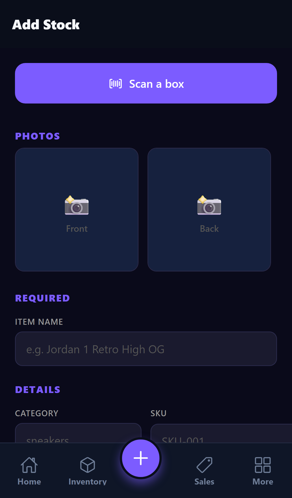

# Smart Scan

**Scan a shoebox. Vendora fills in the item. Everything happens on your phone.**

Smart Scan turns the camera into a stocking tool for resellers. Point it at the
barcode on a box and Vendora fills in the name, style code, size, colorway and
your usual prices, then you save. It uses no outside product databases and no
paid lookup services. The app learns from you.

---

## Live scanner (iPhone XS/XR and newer)

On iPhones with an A12 chip or newer, **Scan a box** opens a live scanner
built on Apple VisionKit (`DataScannerViewController`). It reads the barcode
and the printed label **at the same time**, with no button to press:

- A checklist at the bottom fills in as each field is read: **Barcode, Name,
  Style code, Size, Color**.
- A field only counts once the camera reads the **same value 3 updates in a
  row**. Live text jitters (`DD1391-100` one frame, `DD1391-10O` the next),
  so a one-frame misread never lands in the form. A frame where a field is out
  of view doesn't count for or against it.
- When **barcode + name + size** are in (plus the **style code** whenever the
  label shows one), the phone gives a success tap and the scanner closes on
  its own. Tap **Done** to finish early with whatever has been read.
- Then the same rules as below apply: **scan memory first** (remembered values
  beat what was read), style-family match for a new size of a shoe you know,
  and **nothing you typed is overwritten**.

Recognition runs entirely on the phone. If the phone can't run the live
scanner (older chip, camera access denied, Expo Go, Android, web), or it
stops mid-scan, Vendora falls back to the tap-to-read flow below.

> Status: the live scanner's Swift (`LiveScannerView.swift`) has not yet been
> run on a device. The JS side (voting, checklist, fallback) is unit tested
> with the native view mocked.

## How it works (tap-to-read)

When you tap **Scan a box** and point at the barcode:

1. **Your scan memory (instant).** If you've saved this barcode before, every
   field fills in right away: name, style code, colorway, size, your buy price
   and your sell price. This works with no signal.
2. **Your existing inventory.** If an item you already stock carries this
   barcode, Vendora copies its details.
3. **The box label (read on the phone).** For a barcode Vendora has never seen,
   the camera stays open and asks for the label. Tap **Read label**. Apple's
   on-device text recognition reads the printed label, and Vendora picks out:
   - **Style code**: Nike/Jordan `DD1391-100`, older Nike `555088-134`,
     adidas `GW2871` / `B75806`, New Balance `U9060AAA`
   - **Size**: US sizes over UK/EUR, including kids sizes like `5.5Y`
   - **Colorway**: `WHITE/BLACK-WHITE` becomes `White/Black-White`
   - **Brand and model name**
4. **Same shoe, new size.** If the label's style code matches a shoe you've
   already saved, Vendora fills in everything from that shoe and takes the size
   from the new box.
5. **You confirm, Vendora remembers.** Check the fields, fix anything, and save.
   From then on that barcode fills in instantly, exactly the way you saved it.

If the label can't be read, tap **Type it myself**. You enter the details once
and that barcode is remembered from then on.

## Rules it follows

| Rule | Why |
|---|---|
| **Your corrections always win.** The last thing you saved for a barcode is what it fills next time. | Fixing a misread once fixes it for good. |
| **Never overwrites what you typed.** Scan results only fill empty fields. | Scanning after typing a name won't wipe it. |
| **Remembered beats read.** Saved values win over what the label says. | Your naming and pricing stay consistent. |
| **Works offline.** Memory lives on the phone first, and saves made offline sync to your account when you reconnect. | Convention floors have bad signal. |
| **Follows you.** Memory is stored on your account and downloaded when you open Add Stock. | A new phone knows your barcodes. |
| **Private.** Each account's memory is its own. Nothing is shared or sent to third parties. | Your sourcing is your business. |
| **No guessing.** A field Vendora isn't confident about is left blank. | A blank field beats a wrong one. |

## Under the hood

| Piece | Where |
|---|---|
| On-device label reader (Apple Vision `VNRecognizeTextRequest`) | `mobile/modules/label-reader/` (local Expo module) |
| Live scanner native view (VisionKit `DataScannerViewController`, `.barcode()` + `.text()`, events `onLines` / `onScanError`, `isLiveScanAvailable()`) | `mobile/modules/label-reader/ios/LiveScannerView.swift` |
| Stability voting (N identical consecutive reads) + completion rule | `mobile/services/smartScan/stability.ts` |
| Live scanner UI (checklist, Done, auto-close) | `mobile/components/LiveBoxScanner.tsx` |
| Label parser: style code, size, colorway, brand, name | `mobile/services/smartScan/parseLabel.ts` |
| Phone memory, offline queue, account sync | `mobile/services/smartScan/memory.ts` |
| Add Stock flow (barcode, then label, then confirm) | `mobile/app/(tabs)/inventory/add.tsx` |
| Account memory API | `backend/app/routers/scan.py` |
| Table `scan_memory` (one row per account + barcode) | `backend/app/models/scan_memory.py`, migration `025` |

### API

| Method | Path | Purpose |
|---|---|---|
| `GET` | `/api/v1/scan/lookup?barcode=…&style_code=…` | Memory, then inventory, then style family |
| `POST` | `/api/v1/scan/learn` | Save what the seller confirmed (requires a name) |
| `GET` | `/api/v1/scan/memory` | Download the account's memory for offline use |
| `DELETE` | `/api/v1/scan/memory/{barcode}` | Forget a barcode |

UPC-A and its 13-digit EAN form (`0` + UPC) are treated as the same barcode.

### Tests

- `backend/tests/test_scan_memory.py`: lookup order, corrections, style
  family, inventory match, per-account privacy, validation, auth
- `mobile/__tests__/live-scan.test.tsx`: stability voting, completion rule,
  the live checklist and auto-close with the native view mocked, native
  wrapper fallbacks
- `mobile/__tests__/inventory-add.test.tsx`: live flow in Add Stock (memory
  first, typed fields kept, fallback to tap-to-read)
- `mobile/__tests__/smart-scan.test.ts`: real label text from Nike, Jordan,
  adidas, New Balance and kids boxes, plus offline memory, sync conflicts and
  the retry queue
- `mobile/__tests__/inventory-add.test.tsx`: the full Add Stock scan flow

## Requirements

- **iPhone app build.** The label reader is native code, so it ships in an app
  build, not an over-the-air update. It works on every supported iPhone (iOS
  16.4+, iPhone XR and newer).
- **Web and older builds:** barcode memory still works. The label step is
  skipped and you type the details once.
